<div align="center">

# 📦 Supply Chain Dashboard

**Tableau de bord Power BI de pilotage d'une chaîne d'approvisionnement**
Ventes · Production · Stock · Achats · Livraisons


</div>

> ⚠️ **Projet d'apprentissage.** Il repose sur un jeu de données public et **n'est affilié ni à Samsung ni à aucune autre marque citée**. Les noms de produits proviennent du jeu de données.

---

## 📑 Sommaire

1. [Aperçu du rapport](#-aperçu-du-rapport)
2. [Objectif](#-objectif)
3. [Source des données](#-source-des-données)
4. [Modèle de données](#-modèle-de-données)
5. [Mesures DAX](#-mesures-dax)
6. [Ouvrir le projet](#-ouvrir-le-projet)
7. [Limites connues](#-limites-connues)
8. [Pistes d'amélioration](#-pistes-damélioration)
9. [Structure du dépôt](#-structure-du-dépôt)
10. [Auteur](#-auteur)

---

## 📸 Aperçu du rapport

### Page de synthèse

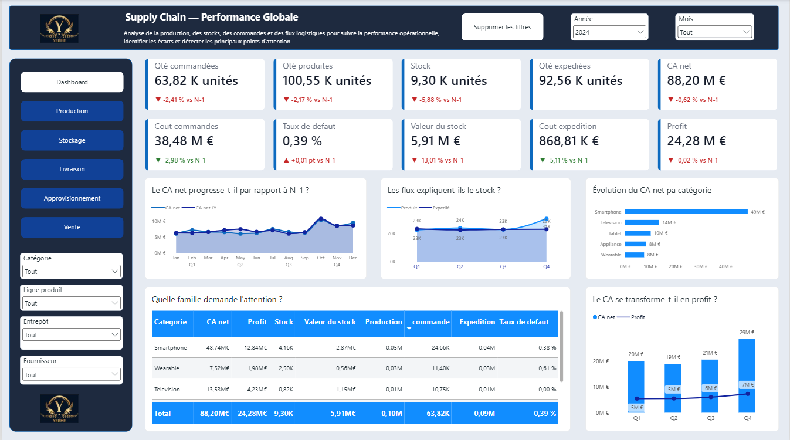

### Pages thématiques

| Production | Stockage |
|:---:|:---:|
| 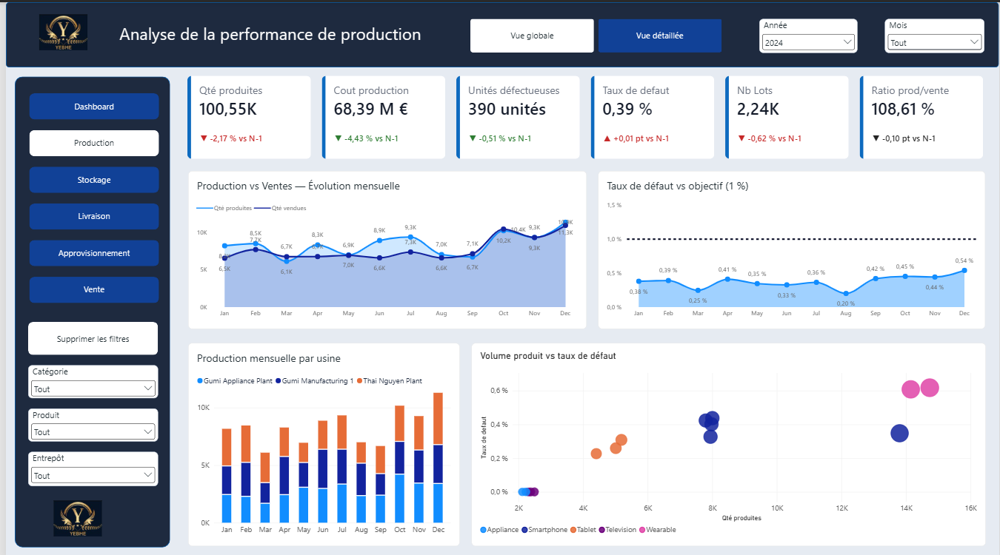 | 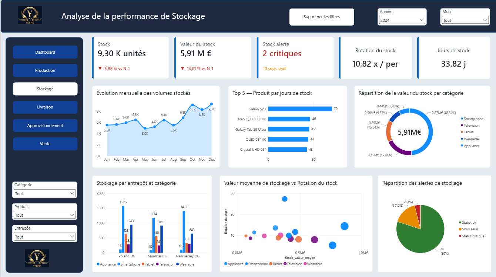 |
| **Livraison** | **Approvisionnement** |
| 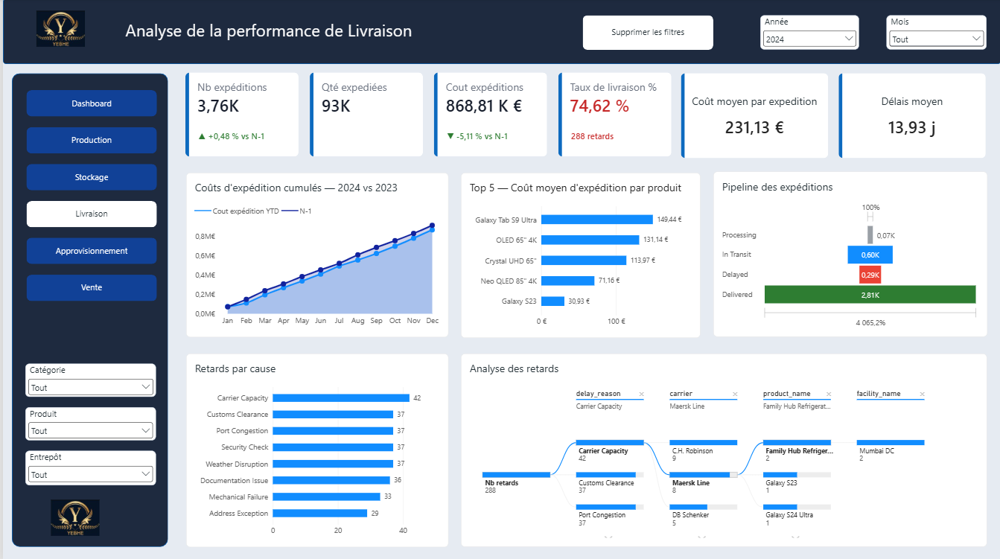 | 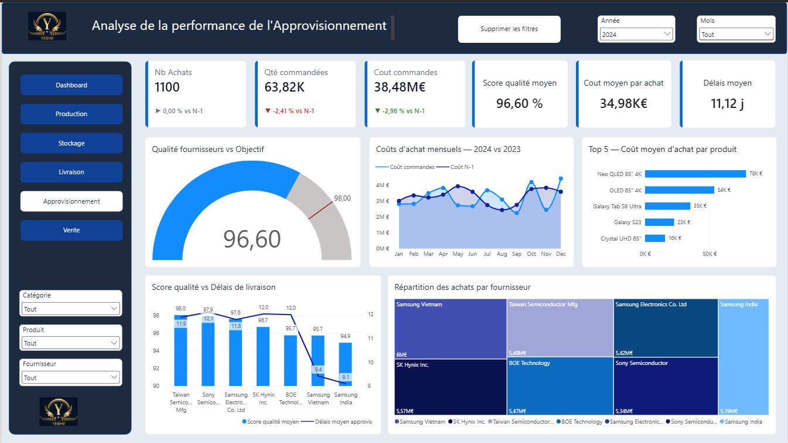 |

### Ventes

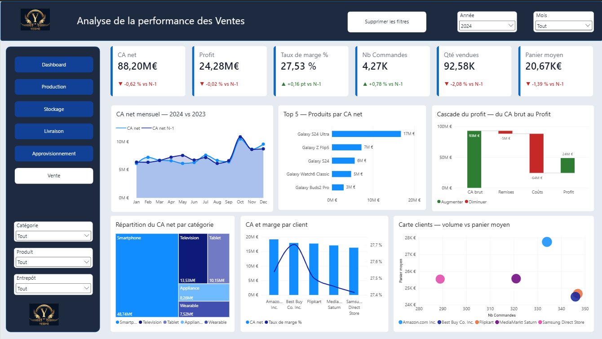

### Pages de détail (drill-through)

Un clic droit sur un produit, un client ou un fournisseur ouvre sa fiche détaillée.

| Fiche produit | Fiche client | Fiche fournisseur |
|:---:|:---:|:---:|
| 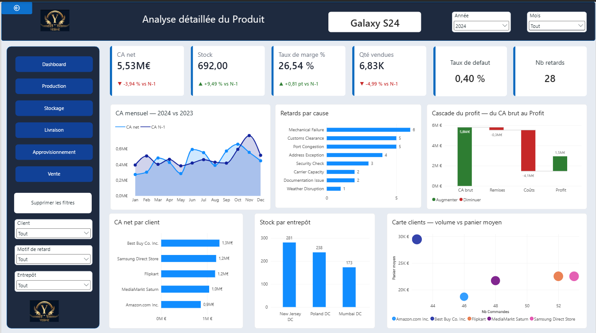 | 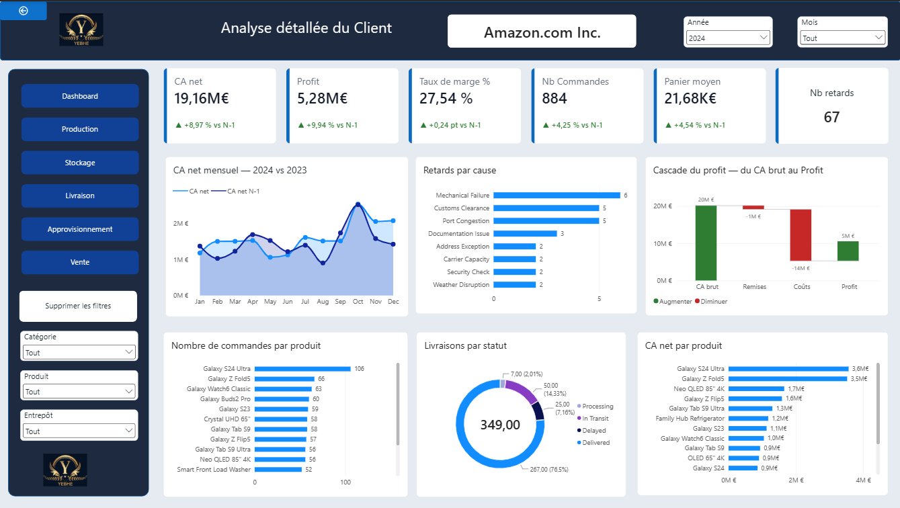 | 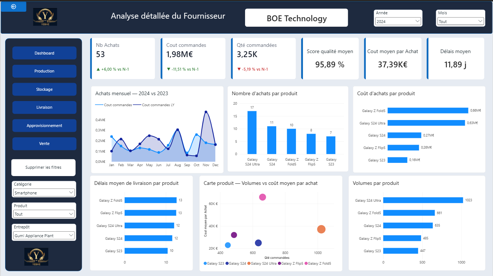 |

---

## 🎯 Objectif

Donner une vue unique de la chaîne d'approvisionnement, de l'achat des composants jusqu'à la livraison au client.

| Domaine | Questions auxquelles le rapport répond |
|---|---|
| 💶 **Ventes / CA** | Quel chiffre d'affaires net, quel profit, quelle marge, quel panier moyen ? |
| 🏭 **Production** | Combien produit-on, avec quel taux de défaut, pour quel coût ? |
| 📦 **Stock** | Quelle valeur de stock ? Combien de produits sous le seuil de réapprovisionnement ou en niveau critique ? Quelle rotation ? |
| 🧾 **Approvisionnement** | Combien de commandes fournisseurs, pour quel coût, avec quel délai et quelle qualité ? |
| 🚚 **Livraison** | Quel taux de livraison, combien de retards, quel délai moyen et quel coût d'expédition ? |

Chaque indicateur est comparé à la **même période de l'année précédente (N-1)**.

### Quelques repères (2023 – 2024)

| Indicateur | Valeur |
|---|---|
| CA net cumulé | ≈ 176,9 M€ |
| Taux de défaut en production | ≈ 0,38 % |
| Expéditions livrées | ≈ 75 % (5 647 sur 7 500) |
| Expéditions en retard | 573 |
| Ratio production / ventes | ≈ 1,09 |

---

## 📊 Source des données

Jeu de données public, couvrant la période **01/01/2023 → 31/12/2024** (731 jours).

Les fichiers CSV **ne sont pas inclus dans ce dépôt**. La procédure de téléchargement est dans [`data/README.md`](data/README.md).

---

## 🧱 Modèle de données

Modèle en étoile : **5 tables de faits**, **5 dimensions**, **16 relations** plusieurs-à-un (filtrage unidirectionnel).

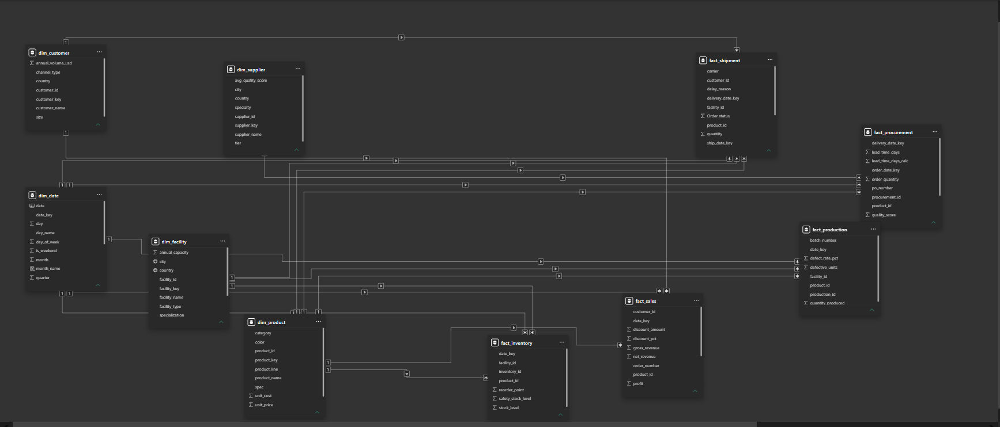

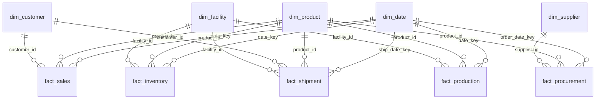

### Tables

| Table | Rôle | Lignes |
|---|---|---:|
| `fact_sales` | Lignes de vente (CA, remises, coût, profit) | 8 500 |
| `fact_shipment` | Expéditions (statut, transporteur, coût, retards) | 7 500 |
| `fact_production` | Production par lot (quantités, défauts) | 4 500 |
| `fact_procurement` | Commandes fournisseurs (coût, délai, qualité) | 2 200 |
| `fact_inventory` | Snapshots mensuels de stock par produit et par site | 1 152 |
| `dim_date` | Calendrier | 731 |
| `dim_product` | Produits | 16 |
| `dim_supplier` | Fournisseurs | 7 |
| `dim_facility` | Sites de production et de stockage | 6 |
| `dim_customer` | Clients | 5 |
| `_Mesures` | Table dédiée aux mesures DAX | 150 |
| `Etape cascade` | Table de support du graphique en cascade | 4 |

---

## 🧮 Mesures DAX

Le modèle contient **environ 150 mesures**, rangées en dossiers d'affichage par domaine.

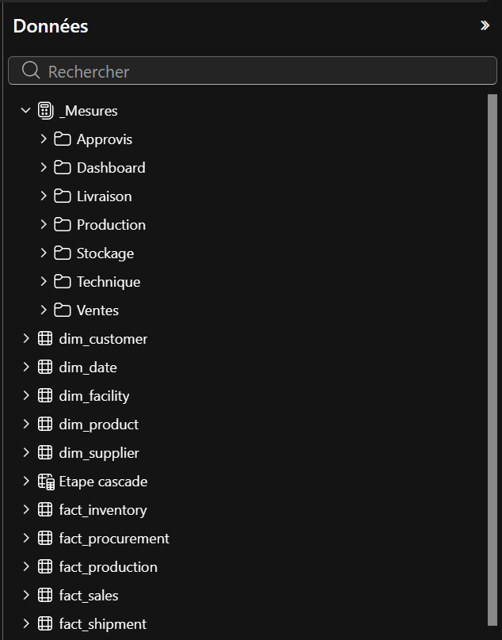

Chaque indicateur suit le même schéma en trois niveaux :

| Niveau | Contenu | Exemple |
|---|---|---|
| **1. Base** | L'indicateur lui-même | `CA net` |
| **2. Comparaison N-1** | Année précédente (`LY`) et variation (`Var %`) | `CA net LY`, `CA net Var %` |
| **3. Affichage carte** | `Delta` (flèche ▲▼ et %), `Texte` (format K / M), `Couleur` (vert / rouge / neutre) | `CA net Delta` |

Les couleurs sont centralisées dans des mesures `_Couleur bon / mauvais / neutre / alerte` (dossier *Technique*). Pour un coût ou un taux de défaut, la logique est inversée : une baisse est verte.

👉 Détail des mesures de base : [`measures/mesures_dax.md`](measures/mesures_dax.md)

---

## 🚀 Ouvrir le projet

1. Télécharger les CSV (voir [`data/README.md`](data/README.md)) dans un dossier local.
2. Ouvrir le fichier `.pbix` dans **Power BI Desktop**.
3. **Accueil → Transformer les données → Gérer les paramètres**, puis renseigner `Chemin_source` avec le chemin du dossier contenant les CSV, **sans antislash final**.
   Exemple : `C:\data\supply_chain`
4. Cliquer sur **Actualiser**.

---

## 🚧 Limites connues

- **Jeu de données synthétique et de petite taille** : 5 clients, 16 produits, 6 sites, 7 fournisseurs.
- **Échelles non alignées entre production et capacité.** La production mensuelle (≈ 8 500 unités) est très inférieure à la capacité mensuelle des sites (≈ 353 000). Le `taux de remplissage %` est donc très bas (≈ 2,4 %). La formule est correcte, car la capacité est proportionnelle au nombre de mois sélectionnés : c'est le jeu de données qui n'est pas cohérent sur ce point.
- **Dates de livraison sans relation avec `dim_date`.** Seules les dates de commande (achats) et d'expédition (livraisons) sont reliées au calendrier. Une analyse « par date d'arrivée » demanderait des relations inactives et `USERELATIONSHIP`.

---

## 🔭 Pistes d'amélioration

- Relations inactives sur les dates de livraison, activées avec `USERELATIONSHIP`.
- Groupes de calcul pour remplacer les mesures répétitives `LY` / `Var %` / `Delta`.
- Sécurité au niveau des lignes par site ou par client.
- Jeu de données plus volumineux et mieux calibré (production par rapport à la capacité).

---

## 📂 Structure du dépôt

```
supply-chain-powerbi/
├── README.md                      ← ce fichier
├── .gitignore
├── supply_chain_dashboard.pbix    ← rapport Power BI
├── data/
│   └── README.md                  ← où télécharger les CSV
├── docs/
│   ├── README.md
│   └── *.png                      ← captures du rapport et du modèle
└── measures/
    └── mesures_dax.md             ← mesures DAX documentées
```

---

## 👤 Auteur

**MAMADOU Lamarana Diallo** · [LinkedIn](https://www.linkedin.com/in/yebhe/)