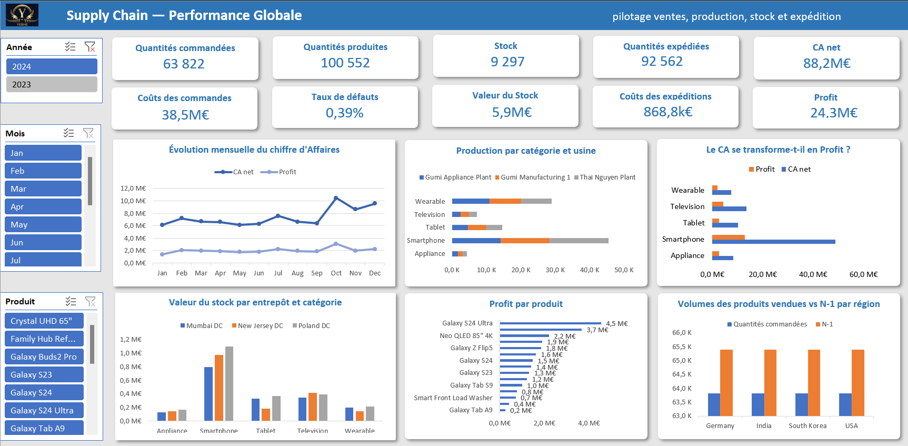

# 📗 Dashboard Excel

Tableau de bord interactif construit dans Excel à partir des mêmes données que le rapport Power BI : de l'import des CSV jusqu'au tableau de bord final.



## Chaîne de travail

```
CSV  →  Power Query  →  Modèle de données  →  Mesures DAX  →  Tableaux croisés  →  Dashboard
```

| Étape | Ce que j'ai fait |
|---|---|
| **1. Import (Power Query)** | 10 requêtes CSV : promotion des en-têtes, typage des colonnes, conversion des décimaux avec les paramètres régionaux en-US, chemin des fichiers centralisé dans un paramètre `chemin_source` |
| **2. Modélisation (Power Pivot)** | Modèle de données de 11 tables : 5 tables de faits, 5 dimensions et une table dédiée aux mesures |
| **3. Calculs (DAX)** | Mesures nommées : `CA net`, `Quantité vendues`, `Quantités vendues LY` (N-1), `Quantités commandées LY`, `Cout commandes`, `Stock`, `Valeur du stock`, `Taux de defaut` |
| **4. Analyse (tableaux croisés)** | 18 tableaux croisés dynamiques sur le modèle de données, regroupés dans la feuille `Calculs` |
| **5. Visualisation** | 6 graphiques croisés dynamiques, 10 cartes KPI et 3 segments |

## Compétences mises en œuvre

| Domaine | Détail |
|---|---|
| **Power Query** | Requêtes paramétrées, nettoyage et typage, gestion des formats régionaux |
| **Modélisation** | Modèle en constellation dans Power Pivot : 5 faits qui partagent leurs dimensions, donc les segments sur `dim_date` et `dim_product` filtrent toutes les tables de faits |
| **DAX** | Mesures de somme, de ratio et de stock, plus la comparaison à l'année précédente (N-1) |
| **Tableaux croisés dynamiques** | 18 tableaux, un par indicateur ou par graphique |
| **Graphiques croisés dynamiques** | Courbe, barres et barres groupées, reliés aux segments |
| **Segments** | Année, mois et produit : un clic met à jour l'ensemble du dashboard |
| **Cartes KPI dynamiques** | Formes liées aux cellules, avec formats personnalisés (`M€`, `k€`) |
| **Mise en page** | Bandeau de titre, grille de KPI, filtres alignés à gauche, zones de graphiques régulières |

## Les indicateurs du dashboard

Quantités commandées · Quantités produites · Stock · Quantités expédiées · CA net · Coûts des commandes · Taux de défauts · Valeur du stock · Coûts des expéditions · Profit.

## Ouvrir et actualiser

1. Ouvrir le fichier avec **Excel 2019 ou Microsoft 365**.
2. Les segments filtrent l'ensemble du tableau de bord.
3. Pour actualiser avec vos propres CSV : **Données → Obtenir des données → Lancer l'éditeur Power Query**, puis modifier `chemin_source` (sans antislash final) et faire **Données → Actualiser tout**.

Sans actualisation, le classeur s'ouvre normalement : les données sont déjà chargées.